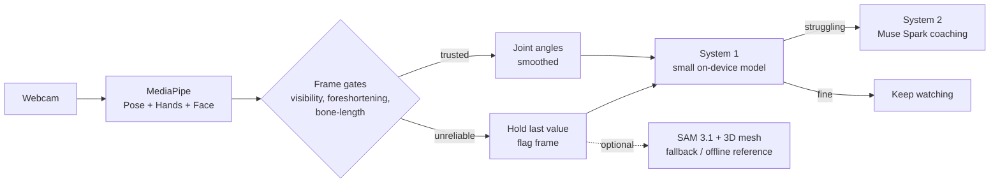

# Second Opinion - Upper-Limb Movement Coaching: A System 1 / System 2 Perception Loop

> Built for the Meta Global AI Developer Hackathon (Oct 26 to Nov 4, 2026).
> **Project name: TODO**

A fast, laptop-only perception loop that watches someone perform an upper-limb movement (we start with **face washing**), estimates their joint angles from an ordinary webcam, detects when they are struggling, and calls a large model for coaching feedback **only when needed**.

## Why

Rehabilitation and self-care coaching needs frequent, timely feedback, but a large model on every frame is slow, costly, and unnecessary. Most of the time nothing is wrong. This project asks a practical question: how few large-model calls can we get away with, while still catching the moments that matter?

## How it works



- **Live perception:** MediaPipe Pose, Hands and Face estimate the arm's joint angles and the hand-to-face distance. The pipeline stays 2D wherever possible. There are no depth cameras and no point clouds.
- **Frame gates:** a 2D joint angle is only trustworthy when the limb is roughly parallel to the image plane. Every frame is checked for:
  - **Visibility:** all three landmarks (shoulder, elbow, wrist) must pass a confidence threshold.
  - **Foreshortening:** projected link length divided by calibrated link length (roughly the cosine of the tilt out of the image plane). Low values mean the limb points at the camera.
  - **Bone-length jump:** world-landmark link lengths must stay close to their calibrated values.
  
  Gated frames hold the last good angle and are flagged.
- **System 1:** a small CPU-only model (gradient-boosted trees or logistic regression baseline, plus a finetuned small pretrained model) reads windows of angles and gate flags and outputs a struggling probability.
- **System 2:** Muse Spark generates coaching feedback when system 1 triggers. It also labels training clips, with spot checks from a registered occupational therapist.
- **Offline reference:** SAM 3.1 plus a 3D body mesh run in batch on recorded clips to measure how far the live 2D angles drift. The mesh is another estimate, not ground truth. Public motion-capture datasets provide real error numbers. If the data says it is needed, the mesh is also called on gated frames.

## Status

| Component | Status |
|---|---|
| MediaPipe live loop with gates, smoothing, CSV logging (`system1_loop.py`) | First version written, needs testing on real webcam and video clips |
| Gate thresholds | Starting values only, to be tuned on recorded clips |
| System 1 baseline and finetuned model | In progress |
| Muse Spark labeling and coaching prompts | In progress |
| SAM 3.1 + mesh offline comparison | In progress |
| Evaluation (angle error, label agreement, calls saved) | Planned |
| Demo UI | In progress |

Results will be added here after the evaluation runs. No accuracy claims are made until then.

## Quickstart

Requirements: Python 3.10+ and a webcam or a video file.

```bash
pip install mediapipe opencv-python numpy
python system1_loop.py --source 0 --arm right --out run.csv        # webcam
python system1_loop.py --source clip.mp4 --arm right --out clip.csv  # video file
```

Press `q` to quit. On first run, the three MediaPipe model files are downloaded into `models/`, which needs an internet connection.

**Start every clip with about 3 seconds of the arm held out to the side, in the image plane, facing the camera.** The loop uses this opening pose to calibrate link lengths. Without it, calibration fails and the loop stops.

### Output columns

| Column | Meaning |
|---|---|
| `t` | Timestamp in seconds (join key for comparing against offline runs) |
| `angle2d_raw` | Elbow angle from image pixels, degrees |
| `angle2d_smooth` | Smoothed 2D angle (One Euro filter, good frames only) |
| `angle3d_world` | Elbow angle from MediaPipe world landmarks, degrees |
| `obs_upper`, `obs_fore` | Observability scores (about the cosine of tilt) for upper arm and forearm |
| `vis_min` | Lowest landmark visibility among shoulder, elbow, wrist |
| `ok` | 1 if the frame passed all gates |
| `reasons` | Why a frame was gated (`low_visibility`, `foreshortened`, `bone_length_jump`, `no_pose`, `calibrating`) |
| `hand_to_face` | Hand-to-nose distance in face widths (empty if unavailable) |

## Filming protocol for volunteers

1. Face the camera with your upper body in frame and good lighting.
2. Hold one arm straight out to the side for about 3 seconds, then perform the movement.
3. For some clips, set the camera at a slightly oblique angle (we are testing whether this reduces foreshortening).
4. Optional: film clips where you simulate difficulty (pauses, repeated failed reaches, shoulder hiking).

## Evaluation plan

- **Joint-angle error:** MediaPipe versus mesh and versus public mocap data, reported separately for gated-OK frames and all frames, and plotted against limb tilt.
- **Label agreement:** Muse Spark labels versus occupational therapist labels.
- **Calls saved:** Muse Spark calls made by the system 1 trigger versus calling on every frame or at fixed intervals. We also report the share of frames escalated to the mesh.
- **Latency and hardware:** timed on an 8 GB laptop and a 16 GB laptop. We claim 8 GB support only if the live loop passes.

## Repository layout

```
system1_loop.py     # live MediaPipe loop, gates, smoothing, CSV logging
models/             # MediaPipe .task files (downloaded on first run, not committed)
```

Further folders (feature extraction, system 1 training, evaluation scripts, UI) will be added as they land.

## Known limitations

- A single front-facing webcam sees movement toward the camera poorly. This is the main source of 2D angle error, and it is why the gates exist.
- Rotation about a limb's own axis (forearm pronation, shoulder internal rotation) cannot be recovered from keypoints alone.
- Calibration uses shoulder width, which shrinks if the torso turns, so the opening pose should face the camera.
- MediaPipe can be confidently wrong when a hand crosses the face or the arm crosses the torso. The visibility gate alone does not catch this, which is why the bone-length check is included.
- Hands are matched to the pose wrist by position, not by the handedness label, since labels can come out mirrored.

## Data and licensing

- Public datasets are used for **validation only**. Licenses are checked before use.
- Model weights (MediaPipe, SAM 3.1, the 3D mesh model, Muse Spark) are subject to their own licenses and terms.
- Volunteer footage is used with consent and is not included in this repository.
- Project license: **TODO**


## Acknowledgments

Built with [MediaPipe](https://ai.google.dev/edge/mediapipe), SAM, and Muse Spark. TODO: add dataset citations once licenses are confirmed.
